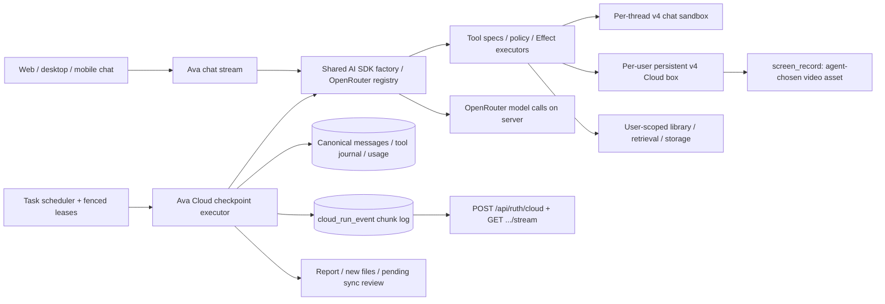

# Ava and Ava Cloud architecture

Ava chat and Ava Cloud share the server-owned AI SDK agent factory, model registry,
tool adapter, policy and image transport. Daytona is a tool target: it runs shell jobs,
files, browser/native applications and the desktop recorder. No model key, run token,
Avenire API credential or agent loop runs inside the box.

## Shared agent stack

`agents/factory.ts` chooses agent kind, system prompt, registry model, image transport,
step limit and bound tools. Chat streams its UI response through AI SDK `streamText`;
Cloud streams one checkpointed step per `streamText` call (see "Manual loop" below). Both use
`tools/ai-sdk.ts`: `execute` runs Effect programs against server services and passes
`toolCallId` into the agent context. Runtime execution is separate from client-safe specs.

Tool policy declares allowed agents and `never` or `unless-full-access` approval.
Computer and isolated box tools never need approval. Chat library mutations keep signed
AI SDK approval requests unless the thread has Full access. Cloud has no direct library
mutation tools: it publishes copies or proposes a reviewed sync. Tool telemetry records
names, ownership, outcome and duration; it excludes raw inputs and outputs.

The old Pi harness, extension, gateway, manifest/tool routes, run-token service and
`cloud_run_token` table have been removed. Vault mounts are detached on box reuse.
Server OpenRouter and Daytona keys are read through Effect Config.

## Tools

| Tool                                                        | Input                                                                                                   | Behavior                                                                                                                                                            |
| ----------------------------------------------------------- | ------------------------------------------------------------------------------------------------------- | ------------------------------------------------------------------------------------------------------------------------------------------------------------------- |
| `computer`                                                  | `action`, optional `x/y`, `toX/toY`, `direction`, `amount`, `text`, `keys`, `region:{x,y,width,height}` | One screenshot/click/double_click/right_click/move/drag/scroll/type/key/hotkey/wait action. Fresh PNG afterward; profile coordinates converted with `toScreen`.     |
| `screen_read`                                               | `mode:tree\|find`, optional `role`, `name`, `limit:1..200`                                              | Compact AT-SPI nodes, actions and converted bounds. Explicit empty/unavailable-tree notice and screenshot/DOM fallback.                                             |
| `box_exec`                                                  | `command`, optional `timeoutSec:1..900`                                                                 | Workspace shell, 64 KiB UTF-8 output cap. Use durable sessions for long jobs.                                                                                       |
| `box_command_start`                                         | `command`                                                                                               | Deterministic Daytona session and persisted command id; returns `jobId` and `commandId`.                                                                            |
| `box_command_status`                                        | `jobId`                                                                                                 | Reattach; null exit code means running.                                                                                                                             |
| `box_command_logs`                                          | `jobId`                                                                                                 | Last 64 KiB of logs.                                                                                                                                                |
| `box_command_cancel`                                        | `jobId`                                                                                                 | Deletes the known job's isolated session.                                                                                                                           |
| `box_read`                                                  | `path`                                                                                                  | UTF-8 regular file, at most 1 MiB; workspace or this user's input root.                                                                                             |
| `box_write`                                                 | `path`, `content`                                                                                       | UTF-8 workspace file, at most 10 MiB. Input-root writes and symlink escapes rejected.                                                                               |
| `box_list`                                                  | optional `path`                                                                                         | At most 200 entries in allowed roots.                                                                                                                               |
| `search_materials`, `list_files`, `find_files`, `read_file` | Existing shared selectors/retrieval inputs                                                              | Always user-scoped.                                                                                                                                                 |
| `hydrate_files`                                             | `selector`, optional `maxFiles`, `maxBytes`                                                             | Hash-skip, capped inputs, LRU eviction and hydration audit.                                                                                                         |
| `publish_output`                                            | `sandboxPath`, optional `title`, `replaces`                                                             | New file in the run folder; `replaces` makes a pending sync.                                                                                                        |
| `publish_report`                                            | `markdown`, optional `status`, `assets`                                                                 | Persist summary and publish selected private assets; server commits report/delivery.                                                                                |
| `publish_asset`                                             | `path`, optional `title`                                                                                | Permanent private media, tagged with thread or Cloud run.                                                                                                           |
| `screen_record`                                             | `action:start\|stop`, optional `label`                                                                  | Chat and Cloud. `start` begins one MP4 of the desktop; `stop` streams it into a private `video` asset and returns `{assetId,url,durationSeconds}`. See "Recording". |

Computer coordinates must be finite integers within the active profile. The keyboard
allow list accepts letters, digits, named navigation/editing keys and F1–F12; hotkeys
are one modifier chord. Typing is at most 10,000 characters without NUL, scroll at most
100 units, and wait at most 10 seconds. Chat has 100 computer actions per turn; Cloud
has 500 per run by default. These are maximum budgets, not targets.

Filesystem tools resolve symlinks and enforce path roots. Shell is intentionally broad
inside the isolated user's box; it is not a security boundary against editing local copies.
It cannot call Avenire with box credentials, and originals only change through approved
server review. Screen/web content is untrusted data, never authorization.

## Models, coordinates and images

Tasks accept registry names `ruth-sprint`, `ruth-core` or `ruth-apex`, defaulting to
`ruth-core`. Their OpenRouter ids remain centralized and configurable in `models/`.
The same task fields are accepted by create/update RPCs. The registry assigns a screen
profile from configured model identity; execution never lets the model select its profile.

The desktop is 1600×900. Tool descriptions and system prompts state exact screenshot
W×H and coordinate kind/range. Profiles are:

| Profile           | Screenshot | Coordinate convention            | Default assignment                         |
| ----------------- | ---------- | -------------------------------- | ------------------------------------------ |
| `pixels-1280x720` | 1280×720   | x 0..1279, y 0..719 image pixels | Claude, Qwen2.5-VL, generic/unknown vision |
| `pixels-1024x576` | 1024×576   | x 0..1023, y 0..575 image pixels | Available explicit profile                 |
| `pixels-native`   | 1600×900   | x 0..1599, y 0..899 pixels       | OpenAI native CUA-class identifiers        |
| `normalized-1000` | 1280×720   | Both axes inclusive 0..1000      | Qwen3-VL                                   |
| `normalized-999`  | 1280×720   | Both axes inclusive 0..999       | Gemini                                     |

Screenshots use `takeCompressed({scale,format:'png'})`. Crops use
`takeCompressedRegion(region,{scale:1,format:'png'})` because SDK 0.220's `takeRegion`
is broken. Crop origin/dimensions are returned explicitly; coordinates still refer to the
full screen. `tools/images.ts` sends file parts in tool-result content for supported routes,
or injects a following user image. Old image payloads are pruned without removing tool ids,
results, text or required reasoning parts. Completed journal results retain screenshot
bytes so fallback images can be restored after a worker restart. Exact hosted endpoint
image perception remains a conformance question; no real-model spend was authorized.

Prompts prefer accessibility or local DOM, then pixels. Each action must be verified on a
fresh screen. An absent/failed accessibility tree is reported explicitly and falls back to
screenshots. Native applications vary in AT-SPI coverage; browser nodes must never be invented.

## Persistent workspace and egress

Cloud uses one persistent box per user, shared v4 snapshot, idle-stop 15 minutes,
auto-archive seven days and disabled auto-delete. Chat uses one ephemeral v4 box per
thread, existing quota/lifetime rules and sweep/cleanup.

Hydrated library copies go to
`/home/daytona/.avenire/<stable-user-slug>/<folder>/<file>`.
The slug normalizes the display name and appends a short user-id hash; unusable names
fall back to `user-<hash>`. `user.cloud_inputs_slug` pins it across later name changes.
The tracked input cache cap is **4 GiB**, preserving disk room for output and recordings
on the 10 GB writable sandbox allocation. Per-call caps remain 200 files/1 GiB; additional inputs are refused once current-run protected copies reach 4 GiB. Unchanged
hashes are skipped, previous paths removed and LRU rows evicted with current-run protection.
Hydration manifests record file ids, hashes, local paths, selection reasons and truncation.
Work/output stays under `/home/daytona/workspace/runs/<runId>/out`.

Task `network` is `packages` by default or explicitly `open`. Package mode uses Daytona's
domain firewall for `registry.npmjs.org`, `pypi.org`, `files.pythonhosted.org`. Open mode
clears both domain/CIDR allow lists. Reapply the task policy before hydration on every
reuse. This protects hydrated files against arbitrary outbound destinations; it does not
make allowed package hosts incapable of accepting user data. Organization-tier restrictions
can further constrain open mode. Chat retains its existing blocked/default configured
allow-list policy. No provider or Avenire host is implicitly allowed for Cloud.

## Checkpoints, leases and recovery

`cloud_run` persists canonical AI SDK model messages, step index, token/cost/action usage,
model name, prompt version, sandbox id, the running recording's id, input slug, lease owner/expiry and
heartbeat. `cloud_tool_call` has primary key `(run_id,tool_call_id)`, name, input,
pending/started/completed status, result, and Daytona session/command ids.

The scheduler serializes claims through the user row and permits one active run per user.
Each claim has a distinct fence token and a five-minute lease; the executor heartbeats every
30 seconds. Expired runs are prioritized over fresh work and resumed in place. The old
"dead worker → failed run" sweep is gone. Writes and tool execution check the fence.

A Cloud model call runs one streamed AI SDK step with `stopWhen` and image-pruning `prepareStep`.
The executor commits the canonical assistant message and tool-call ids **before** executing
any tool. It then executes calls serially and saves each result. Restart reloads messages,
finds unresolved call ids, returns completed journal results or reconciles the world, and
continues with the next model step. Journal-write failures pause the same unresolved call instead of sending an error result that could invite a duplicate publication. Infrastructure/model-request failures use the task retry allowance with a five-minute resume lease; retries keep the same run and call ids. Provider calls interrupted before a response checkpoint
may repeat and incur extra usage; exactly-once provider billing is not guaranteed.

Hydration manifests, published file/proposal ids and media asset ids are deterministic by
tool call. Lost-result retries discover those records before republishing. Writes replay the
same bounded path/content. Long jobs use deterministic session ids and reconnect to existing
command ids. Uncertain computer mutations are reconciled with a screenshot instead of a
second click/type. Uncertain `box_exec` returns a conflict requiring world inspection rather
than rerunning an arbitrary command.

Worker shutdown preserves commands, box and checkpoint; it expires the lease. Report message,
terminal state and email outbox enqueue commit in one transaction; a stored report id prevents
duplicates. A recording the agent left running is finalised first (see "Recording"), and its link
goes into the report.
Final cleanup terminates known sessions, meters box time and stops the box. Metering and cleanup markers are saved in the usage checkpoint; expired terminal leases resume collection/cleanup without another model call or report. Failed recording or box-stop cleanup retains the lease for retry.

Budgets: 500 model steps, 500 computer actions, four-hour wall clock including resumed time,
and configurable `RUTH_CLOUD_MAX_COST_USD` (default $5) using actual OpenRouter usage metadata.
The next step is stopped after the reported cost reaches the cap; an individual request can
overshoot it. Missing provider cost metadata cannot prove a dollar limit.

## Execution vs delivery

Execution stays in the worker: the scheduler claims a run with a fenced lease and the executor
runs the manual loop. Delivery is separate and best effort: the executor writes the run's AI SDK
UI message chunks to Postgres, and the web process only replays and tails them. A dropped client,
a slow viewer or a lost event batch never affects the run.

- `cloud_run_event(run_id, seq, chunk jsonb, terminal, created_at)`, primary key `(run_id, seq)`.
  `seq` is dense per run and one chunk is one row, so a client that counts chunks knows its
  offset. A unique index allows one `terminal` row per run. Consecutive text, reasoning and
  tool-input deltas of one part are coalesced before insert.
- The executor owns the run-level frame: `start` (message id = run id) is written once, when
  the run begins (a resumed executor continues the same sequence), and the terminal row is
  `finish` (succeeded), `error` + `finish` (failed) or `abort` (cancelled), written after the
  report commits. A stale writer that lost its lease collides on `(run_id, seq)` and fails with
  `RunEventConflict`, which the executor treats as a lost lease. A run cancelled while still
  queued never gets a terminal row; the reader synthesizes the closing chunks from the run status.
- Event bytes are bounded: tool results carry screenshot metadata but not the PNG data (the
  model-side image transport and the journal are unchanged).

Routes (session auth; one user can only see their own runs):

| Route                                           | Behavior                                                                                                                                                                                                                                                                                                                              |
| ----------------------------------------------- | ------------------------------------------------------------------------------------------------------------------------------------------------------------------------------------------------------------------------------------------------------------------------------------------------------------------------------------- |
| `POST /api/ruth/cloud`                          | Body `CloudRunRequest`: `{prompt, model?, network?, timeZone?}` for a one-off run (a hidden `cloud_task.one_off` task), or `{taskId}` to run an existing task now. Enqueues the run and returns its stream in `createUIMessageStreamResponse` format, with the run id in `x-ruth-run-id`. 409 if that task already has an active run. |
| `GET /api/ruth/cloud/[runId]/stream?from=<seq>` | Replays from `from` (default 0), then tails until the terminal row. Resumable: `useChat({ id: runId, resume: true })` reconnects to exactly this path and replays the run from the start; a client that counts chunks can pass `from`. 404 for another user's run.                                                                    |

Both routes enqueue or read only. The worker's scheduler polls for claimable queued runs every
two seconds (alongside its one-minute tick, which stays the safety net for due tasks and expired
leases), so a posted run starts without waiting for the tick. Stream tailing also polls
(every 400 ms, one indexed query per active viewer) instead of LISTEN/NOTIFY: it needs no
connection per viewer or listener lifecycle, nothing is lost when a notification is missed during
a reconnect, and the log is the only state a resumed client needs. `apps/web/src/features/ruth/CloudRunView.tsx`
holds the client helper (`useCloudRun` to start or resume, `CloudRunView` to render a run with the
same message rendering as chat).

## Manual loop (per-step streaming and finish reasons)

The loop is the AI SDK "Manual Agent Loop" pattern: one model step per `streamText` call, with
tools defined without `execute` (`stopWhen: stepCountIs(1)`) so the model only declares calls.
The step's tokens stream through `toUIMessageStream` into the event log (batched every 250 ms or
64 chunks, with `start`/`finish` omitted because the executor owns them); the loop then awaits the
step's `response.messages`, `finishReason` and usage, commits the canonical assistant message and
tool-call ids, runs the tools itself, commits each result, and emits `tool-output-available` or
`tool-output-error` chunks for them. Provider call settings (parallel tool calls, usage accounting)
live in `models/index.ts`, not in the loop.

| `finishReason`            | Loop action                                                                                                         |
| ------------------------- | ------------------------------------------------------------------------------------------------------------------- |
| `tool-calls`              | Run the pending tools and continue.                                                                                 |
| `stop`                    | Final answer (pending calls, if any, still run first).                                                              |
| `length`                  | Cut off: append a user message asking the model to continue, at most twice in a row, then fail with a clear reason. |
| `content-filter`, `other` | Fail the run (not retryable).                                                                                       |
| `error`                   | Fail the step as a retryable infrastructure failure: the task's retry allowance resumes the same run.               |

## Recording

The agent decides when to record; prompts say to record only when showing a process is the point.
`screen_record` (`tools/recording.ts`) targets the same sandbox as `computer` (`targetFor`):
the chat thread's sandbox or the user's Cloud box, via Daytona's recording API.

- `start` labels the recording `ruth-<runId|threadId>-<toolCallId>`; a second start (or a resumed
  one) reports the recording already running. Cloud journals the recording id in
  `cloud_run.recording_id`; chat finds its recording by the thread label.
- `stop` stops the recording, streams the MP4 to a temp file (hashing as it goes) and into the
  private asset store (`video`, tagged with thread or run), clears the journal, deletes the box's
  copy, and returns `{assetId, url, durationSeconds}`. The asset id is deterministic per Cloud
  tool call, so a replayed `stop` returns the stored asset instead of uploading again.
- At the end of a run the executor finalises only a recording the agent left running
  (`recording_id` still set), as `recording` in the report. It never starts one.

## Review and private outputs

`publish_output` creates a new library file in the run folder. With `replaces`, it stores an
independent proposed object and a pending approval. Morning review rechecks the original
hash, exposes conflicts and updates originals only on user acceptance. Skips leave originals
alone. Original storage, chunks and metadata are never replaced by agent tool execution.

AssetStore provides permanent private `/a/<signed-id>` links; possession does not bypass
owner authorization. Widgets retain their separate sandboxed origin, short-lived widget
tokens, CSP and trusted kit routes. Chat widget preview/render and asset rendering are
unchanged by the computer-use migration.

## Conformance and validation

`pnpm --filter @avenire/ai conformance -- --model <OpenRouter-id> --max-steps 20`
creates a temporary v4 sandbox, opens a known local Chromium fixture, requests two clicks,
a word and scroll, scores actual DOM state and reports image transport. It always deletes
the box. **Do not run real-model conformance without owner spend approval.**

`--mock` uses the AI SDK mock model with the same live executors and zero provider calls;
`--profile <profile-id>` selects each convention. Reports go to `/tmp/ruth-computer-use/`.
Fake tests cover coordinate conversion, action validation, image transport, lost checkpoint
resume without duplicate hydration/publish, lease reclaim, the event log (append, replay, resume),
finish-reason handling, `screen_record` against a fake box, network policy and Unicode/stable
hydration roots. Full-workspace checks and a dev-only migration
must pass separately; fake tests do not establish production or four-hour runtime behavior.
