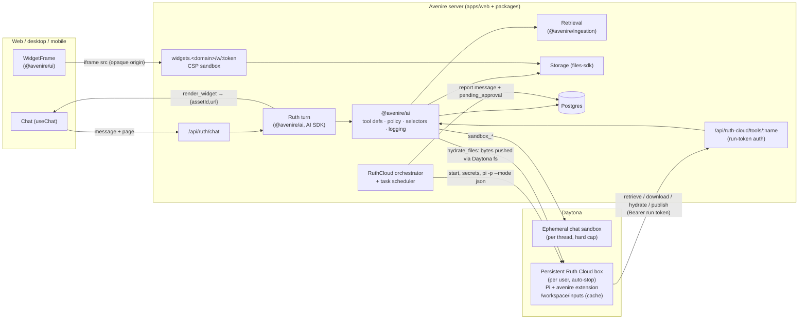

# Ruth and Ruth Cloud — architecture

Ruth is Avenire's agent. It comes in two forms that share one tool backbone:

- **Ruth** (chat): an AI SDK `streamText` turn, streaming into the chat. Short-lived compute in
  an ephemeral Daytona sandbox; file actions gated by approvals; widgets rendered inline.
- **Ruth Cloud**: the Pi agent harness running in a **persistent, per-user Daytona sandbox**
  for scheduled and long-running work. It reaches the user's library only through retrieval
  and on-demand hydration, publishes results as new files, and proposes changes to originals
  for a morning review.

Both import their tools from explicit `@avenire/ai/tools/*` and `@avenire/ai/cloud/*`
subpaths: one definition per tool (schemas,
permission policy, execution, logging), adapted to the AI SDK for chat and to an HTTP gateway
plus a Pi extension for Cloud.



## 1. Shared tools in `@avenire/ai`

Tool core, client-safe specs, selectors and the AI SDK adapter live in `src/tools/`.
`@avenire/ai/tools` remains the client-safe chat spec entry point; execution modules
are imported separately. Widget wrapping and the shared asset store live in `src/outputs/` and are
exported as `@avenire/ai/outputs/widgets` and `@avenire/ai/outputs/assets`.
Cloud hydration, publishing, review, run tokens and the gateway live in `src/cloud/`.

A tool is defined once:

```ts
interface ToolDef<I, O, R> {
  name: string; // snake_case, identical in chat and in Pi
  description: string;
  input: Schema.Codec<I>; // Effect Schema; JSON Schema derived for the model / Pi
  output: Schema.Codec<O>;
  agents: ReadonlyArray<"ruth" | "ruth-cloud">;
  /** `gateway` scope a Ruth Cloud run token must hold (cloud tools only). */
  scope?: "retrieval" | "download" | "hydrate" | "publish";
  approval: "never" | "unless-full-access";
  execute: (input: I, ctx: AgentContext) => Effect.Effect<O, RuthToolError, R>;
}
```

- `AgentContext` = `{ userId, agent: "ruth" | "ruth-cloud", threadId?, runId?, fullAccess }`.
  Every query is scoped by `ctx.userId`; nothing takes a user id from model input.
- `RuthToolError { tool, code, message, recoverable }` with codes `invalid_input`,
  `not_found`, `forbidden`, `denied`, `conflict`, `timeout`, `quota_exceeded`,
  `sandbox_unavailable`, `failed`. Messages are written for the model ("The sandbox could not
  start; try again or answer without running code"). Defects become a generic message.
- **Logging:** every call is wrapped in a span `RuthTool.<name>` and one structured log line
  plus an `Analytics` event `ruth_tool_call` with `{ tool, agent, userId, threadId, runId,
outcome, errorCode, durationMs }`. Inputs are not logged (they can contain the user's text).
- **Adapters:**
  - `toAiSdkTools(defs, ctx, services)` → AI SDK `tool()`s. `approval: "unless-full-access"`
    maps onto the AI SDK 7 approval flow (pending state is the tool part's
    `approval-requested`; denial reaches the model as a denied tool result).
  - `gateway` → `handleToolCall({ token, name, input })` for the HTTP route: verify the run
    token, check the tool is a cloud tool within the token's scopes, decode, execute with a
    `ruth-cloud` context, encode. `toolManifest()` returns `{ name, description,
inputJsonSchema }[]` for the Pi extension.
  - `pi/avenire-extension.ts`: a static Pi extension (TypeBox via `Type.Unsafe(jsonSchema)`)
    that fetches the manifest at start-up and registers each tool; `execute` POSTs to the
    gateway with `Authorization: Bearer $AVENIRE_RUN_TOKEN`.

### Tools

| Tool                                                                              | Ruth | Cloud         | Approval                                                                 | Notes                                                                |
| --------------------------------------------------------------------------------- | ---- | ------------- | ------------------------------------------------------------------------ | -------------------------------------------------------------------- |
| `search_materials`                                                                | ✓    | ✓ (retrieval) | never                                                                    | multi-lane retrieval, unchanged ranking                              |
| `list_files`                                                                      | ✓    | ✓ (retrieval) | never                                                                    | folders act as folders; `inbox` pseudo-folder                        |
| `find_files`                                                                      | ✓    | ✓ (retrieval) | never                                                                    | metadata + time + topic via the shared `FileSelector` resolver       |
| `read_file`                                                                       | ✓    | ✓ (download)  | never                                                                    | extracted text by chunk range (replaces `read_file`)                 |
| `write_file`                                                                      | ✓    | —             | unless-full-access                                                       | new note file in a folder                                            |
| `move_file`, `rename_file`                                                        | ✓    | —             | unless-full-access                                                       |                                                                      |
| `archive_file`                                                                    | ✓    | —             | unless-full-access                                                       | "delete" = archive; purged after 30 days. No permanent delete exists |
| `sandbox_exec`, `sandbox_write`, `sandbox_read`, `publish_asset`, `sandbox_close` | ✓    | —             | never                                                                    | ephemeral chat sandbox                                               |
| `render_widget`                                                                   | ✓    | —             | never                                                                    | → `{ assetId, url }`                                                 |
| `get_page_context`, `load_skill`, `ask_user`                                      | ✓    | —             | never                                                                    | unchanged                                                            |
| `hydrate_files`                                                                   | —    | ✓ (hydrate)   | never                                                                    | selector → files pushed into `/workspace/inputs`                     |
| `publish_output`                                                                  | —    | ✓ (publish)   | never (outputs are new files; changes to originals become pending syncs) |
| `publish_report`                                                                  | —    | ✓ (publish)   | never                                                                    | the run's report markdown + asset paths                              |

Ruth Cloud has no write/move/rename/archive tool: it **never writes to originals**. A changed
copy of an original is published with `publish_output({ sandboxPath, replaces: fileId })` and
becomes a `pending_approval` sync that the user accepts or skips in the morning.

`run_python` and `propose_file_action` are removed. A single script is `sandbox_write` then
`sandbox_exec`.

## 2. Ruth (chat)

- **Sandbox (`@avenire/cloud/chat-sandbox`, `ChatSandboxes`).** One sandbox per thread,
  created lazily on the first `sandbox_*` call (labels `app=ruth-chat, userId, threadId`).
  Resources come from `@avenire/cloud/snapshots` (shared with the snapshot build); network blocked except the package-index allow list
  (`CHAT_SANDBOX_NETWORK_ALLOW_LIST`); `autoStopInterval` 15 min + `autoDeleteInterval` 0 as
  the safety net; a **hard wall-clock cap** (60 min from creation) after which a sweeper
  deletes it regardless (the sweeper lists by label, so it survives restarts). Per command:
  120 s default, 900 s max; tool output to the model capped at 64 KB, `sandbox_read` at 1 MB,
  published assets at 50 MB. The prompt tells Ruth to call `sandbox_close` when the task is done
  unless it is waiting for the user, and to close it after that follow-up.
  Daily quota: 60 sandbox-minutes per user (`sandbox_usage`), 3 concurrent chat sandboxes.
  Nothing a sandbox produces is written to the database.
- **Assets.** `publish_asset({ path, title? })` copies a sandbox output (up to 50 MB) into
  `users/<id>/.avenire/assets/<assetId>/<safe-name>`, creates a private `asset` row, and
  returns `{ assetId, url, kind, mediaType, name, sizeBytes }`. These are permanent outputs,
  separate from indexed library files. The tool result is the chat UI part: web displays
  images, videos with controls, and PDF/file download links; mobile displays authenticated
  native images and opens other links in an external browser. No expiry folders, TTL or
  output sweeper remain.
- **Files.** The library is files in folders; folders act as folders. Tools work on files,
  not raw bucket keys (the Files SDK's own AI tools address raw keys, which would bypass files
  and indexing and expose the storage layout); the Files SDK remains the storage layer, and
  the approval mechanism is the same AI SDK flow the Files SDK tools use.
- **Widgets** (§4).

## 3. Ruth Cloud

### Tasks and runs

A `cloud_task` is `{ title, prompt, schedule, timeZone, preHydration[], delivery, enabled }`
where `schedule` is `{ type: "cron", expression }` or `{ type: "once", at }` (Effect
`Cron`, evaluated in the task's time zone). The old nightly digest is the built-in task
`nightly-digest` (cron `0 3 * * *`, pre-hydration "files touched today", email on).

The scheduler ticks every minute in the worker process (`apps/web/src/server/worker.ts`). It
creates `cloud_run` rows for due tasks (unique per `taskId, scheduledFor, attempt`; missed
occurrences after downtime coalesce into one) and claims runnable ones atomically. **One run
per user is active at a time**: the user has one box, one token secret and one `run.json`,
so runs of different tasks queue. A global `RUTH_CLOUD_CONCURRENCY` bounds the worker. A run
still active 30 minutes past the wall clock since its claim belongs to a dead worker and is
failed, freeing the slot. A run:

1. mints a run token (§3.4) and writes it into the user's Daytona secret;
2. starts (or creates) the user's box and writes `/home/daytona/workspace/.avenire/run.json`
   (`runId`, `apiBaseUrl`; no secrets), the extension and the run's `prompt.md`;
3. applies the task's pre-hydration rules (a failing rule is reported, not fatal);
4. runs Pi as an async Daytona session command, tailing its JSON events into the run log,
   under a 4-hour wall clock (cancellation is checked every poll):

   ```sh
   PI_TELEMETRY=0 pi -p --mode json --no-session --offline --no-approve --no-extensions \
     --no-skills --no-prompt-templates --no-context-files --provider anthropic \
     --model <RUTH_CLOUD_PI_MODEL> --extension /home/daytona/.avenire/pi/avenire.ts \
     @/home/daytona/workspace/runs/<runId>/prompt.md
   ```

   The discovery flags load only our extension and prompt; `--offline` skips update checks
   but not provider calls. The extension (`packages/ai/pi/avenire-extension.ts`) fetches the
   gateway's tool manifest in Pi's async factory and registers each tool before the first turn;

5. on exit, collects the report (from `publish_report`, else the last assistant message, else
   a fallback), stores the recording, posts the report to the user's **Ruth Cloud thread**
   and sends the email if enabled;
6. always, even on failure or interruption: revokes the token, clears the secret, ends the
   session, records Cloud seconds and stops the box.

Infrastructure failures (box start, Pi crash, timeout) retry with backoff up to
`maxAttempts` (default 2); a run whose agent reports failure does not retry.

### Hydration

`hydrate_files({ selector, maxFiles, maxBytes })`:

```ts
FileSelector = {
  time?: { since?, until?, lastDays?, today?, events?: ("opened"|"edited"|"captured"|"uploaded")[] },
  topic?: { query, minRelevance? },
  filters?: { kinds?, folderIds?, tags?, sources? },
  explicit?: { fileIds?, folderIds?, captureIds? },
}
```

Parts combine with AND ("PDFs on thermodynamics touched this week" =
`topic` ∧ `filters.kinds` ∧ `time.lastDays: 7`). Resolution: metadata candidates from SQL
(`file`, `file_event`, `capture`, `file_folder`), then, if `topic` is set, retrieval restricted
to those file ids, scored per file by its best chunk relevance. Each returned file carries a
`reason` ("edited 2026-10-08 · matches 'thermodynamics' 0.82").

Files are pushed by the server into `/workspace/inputs/<folder>/<title>.<ext>` through the
Daytona API (the sandbox never holds storage credentials). Hydration is idempotent: a file
whose `contentHash` matches `cloud_workspace_file` is skipped. Count and byte caps apply
(defaults 200 files, 1 GB per call), the workspace is an LRU/age cache capped at 10 GB (files
used by the current run are never evicted), and every call is recorded in `cloud_hydration`
with its selector, trigger (`pre-hydration` or `agent`) and manifest.

**Why on-demand hydration.** Copying a user's whole library into a sandbox would be slow,
expensive and a needless exposure of material the task never touches. Hydrating by selector
keeps the workspace small, makes every run's inputs auditable, and lets Ruth Cloud widen its
inputs when it discovers it needs more. **The trade-off:** Ruth Cloud can only reach what
retrieval and metadata can find. A file with poor extraction, no events, or a misleading
title may never be hydrated, so retrieval quality bounds Ruth Cloud's reach. Mitigations:
explicit selectors (file, folder, capture), the hydration log in every report (so a miss is
visible), and the same retrieval engine and benchmark as chat Ruth.

### Publishing and the morning review

- `publish_output({ sandboxPath, title? })` uploads the file as a **new file** in the run's
  folder ("Ruth Cloud · <date> · <task>"), `source = "ruth-cloud"`, queued for indexing.
- `publish_output({ sandboxPath, replaces: fileId })` stores the bytes under
  `users/<id>/.avenire/cloud/<runId>/sync/` and creates a `pending_approval` (`kind = "sync"`)
  with the hydrated `baseHash`. If the original changed since hydration it is flagged
  `conflict` at publish time and re-checked at accept time.
- The review is backend-only for now: `cloud.listPendingApprovals`, `cloud.resolveApproval
({ id, decision: "accept" | "skip" })`, `cloud.resolveRun({ runId, decision })`. Accepting
  writes the new bytes to the original, bumps `contentHash` / `contentModifiedAt`, records an
  `edited` event and re-indexes. Nothing touches originals until accepted.

### Secrets, tokens and egress

- **Model key:** a dedicated, spend-limited, revocable key stored as a Daytona organisation
  secret (hosts: the model provider), mounted as `ANTHROPIC_API_KEY`. The sandbox only sees
  Daytona's placeholder; the real value is substituted at egress.
- **Run token:** 32 random bytes, stored hashed in `cloud_run_token` with
  `{ userId, runId, scopes: [retrieval, download, hydrate, publish], expiresAt = run cap }`,
  written into the user's Daytona secret `ruth-cloud-token-<userId>` (hosts: the API host),
  mounted as `AVENIRE_RUN_TOKEN`, revoked (and the secret rotated) when the run ends.
- **API base URL:** a plain value in `run.json`, not a Daytona secret. Daytona substitutes a
  secret only inside requests to its allowed hosts, so a placeholder cannot stand in for the
  host itself. It isn't sensitive; in development it points at a tunnel.
- **Egress:** `networkAllowList` = model provider + API host CIDRs (`RUTH_CLOUD_EGRESS_CIDRS`).
- Pi is pinned (`@earendil-works/pi-coding-agent@0.83.0`) in the box snapshot.

## 4. Assets, links and widgets

### Permanent private outputs

`Asset { id, kind, title, mediaType, sizeBytes, createdAt, threadId?, runId?, url }` is the
client contract. Kinds are `widget | image | video | pdf | file`. `AssetVisibility` currently
accepts `private`; extend it with `link` and `people` when sharing is implemented. The
`asset` table replaces `artifact`, with owner, storage key, SHA-256 content hash, byte size,
optional thread/message/run links, private visibility and creation time. User/thread/run
indexes support `assets.get({ assetId })` and `assets.list({ threadId?, runId? })`.

`AssetStore` in `outputs/assets.ts` owns `put`, `get`, `list`, `url` and storage reads.
`WidgetStore` owns only document wrapping and short widget tokens; it calls AssetStore
with `kind: "widget"`. Cloud recordings and `publish_report({ markdown, assets?: paths })`
attachments use the same store. `publish_output` continues to create indexed library files
or pending syncs, preserving the current Cloud workflow.

Every output has a permanent `${APP_URL}/a/<token>` link. The token signs the asset id with
a domain-separated HMAC and has no expiry; keep `ASSET_SIGNING_SECRET` stable (blank falls
back to `WIDGET_SIGNING_SECRET`). Possessing this token does not grant access. The `/a/`
route resolves it, reads the real session, and calls **`authorizeAsset(asset, viewer)`**.
Today that hook permits only the owner; missing/other-owner assets return 404 and missing
sessions return 401. RPC get uses the same hook and lists are scoped by session owner.

Future sharing adds an `asset_share` list keyed by asset id and grantee/link permission.
Extend `authorizeAsset` to consult that list rather than adding authorization checks to
individual routes or tools; broaden listing queries for granted assets at the same time.
There is no sharing UI or share-grant bearer token today.

For images/videos/PDFs/files `/a/` redirects to a 10-minute presigned storage URL. The
filesystem driver streams authenticated bytes. `?download=1` binds
`Content-Disposition: attachment` in the presigner or streamed response; widgets can be
downloaded as HTML too. Redirects and responses use private/no-store caching. HTML files
are downloaded by default, and streamed output responses are CSP sandboxed.

For a widget `/a/` issues a domain-separated HMAC token containing the asset id and expiry,
then redirects to `${WIDGET_ORIGIN}/w/<shortToken>`. `/w/` verifies the 10-minute expiry,
checks that the asset kind is widget and serves the stored document on the isolated host.
It keeps its sandbox CSP, nosniff/referrer/CORP headers and no-store caching so an expired
short token cannot keep serving from the browser cache. The permanent `/a/` link can always
issue a fresh short token after authorization.

**Mobile follow-up:** external browsers lack the native app's session cookie; widget/video/
PDF/file links may require a separate browser sign-in. Native image requests attach the
mobile cookie. A native authenticated WebView or session handoff is future work.

### Preview, render and kits

1. Load `visuals` (and the relevant chart/simulation/anatomy and kit-api skills), then call
   `get_page_context` for width, appearance and tokens.
2. `preview_widget({ html, width?, appearance? })` clamps width to 240–1600 px (default: chat
   column, then 640 px), reuses the thread's ChatSandboxes service and uploads the built kits
   only when the sandbox's manifest hash differs. It uses Python 3.13 Playwright/Chromium at
   `/opt/avenire/browsers` with a localhost HTTP server, the same theme/bootstrap/CSP wrapper,
   a load plus one-second wait and a full-page PNG (20,000 px capture cap).
3. Inspect `{ width, contentHeight, consoleMessages, screenshot }`, revise, and preview again.
   Console levels log/info/warning/error/uncaught are capped at 100 entries and 2,000 UTF-8
   bytes per entry. Page errors remain results; browser/infrastructure/quota errors become
   recoverable tool errors. Preview never requires approval; sandbox lifetime/quotas apply.
4. `render_widget({ title, html })` validates raw HTML ≤512 KB and stores the wrapped widget
   through AssetStore, returning `{ assetId, title, url }`. Explain the result in chat prose.

The widget bootstrap applies first-paint theme tokens, receives validated theme updates,
reports height and reports runtime errors. WidgetFrame uses `sandbox="allow-scripts"`, an
opaque origin, its own contentWindow message filter and an error/retry state.

Build `@avenire/widget-kit` before web dev/build (explicit build commands in web `dev`/`build` scripts). Production
serves only manifest-listed kit files on the widget host. `/kits/math.js`, `/kits/iso.js` and
`/kits/iso-gl.js` redirect to `/kits/<manifest-sha256>/<name>`; only those hashed responses
use one-year immutable caching. Next output tracing includes the built kits for deployment.
Kit responses set `Access-Control-Allow-Origin: *` for opaque module `Origin: null` requests,
`Cross-Origin-Resource-Policy: cross-origin` and nosniff. The app host rejects `/w/` and
`/kits/`; the widget host rejects every other route.

Both the document CSP meta and `/w/` response CSP allow `${WIDGET_ORIGIN}/kits/` scripts.
Inline scripts/styles, data/blob images/media and data fonts remain allowed, while
`connect-src 'none'`, `base-uri 'none'`, `form-action 'none'` and frame-ancestor restrictions
keep the document isolated. Tokens come from `@avenire/ui/tokens`; kits expose math,
`kitScript()`/iso CSS, and iso WebGL through the documented API.

### OpenRouter models and image feedback

Ruth chat uses `@openrouter/ai-sdk-provider@3.1.0` (`ai@7` compatible). Registry names and
`RUTH_MODEL_SPRINT/CORE/APEX` overrides remain; defaults are
`anthropic/claude-haiku-4.5`, `anthropic/claude-sonnet-5.5`, `anthropic/claude-opus-5.5`, verified
against OpenRouter's public catalog. The server key is `OPENROUTER_API_KEY`.
The provider changelog introduced v7 support in 3.0.0 and fixed flattened multimodal tool
results in 2.3.2; 3.1.0 retains structured V4 file/tool content.

The per-model capability registry derives `vision` from catalog
`architecture.input_modalities`. `toolResultImages` defaults true for Anthropic/OpenAI/Google
ids and false otherwise. `RUTH_MODEL_<SLOT>_VISION` and
`RUTH_MODEL_<SLOT>_TOOL_RESULT_IMAGES` override those decisions. Catalog failure warns and
uses verified default metadata; unknown overrides conservatively become text-only.

`tools/images.ts` accepts PNG bytes plus id/size/dimensions and produces AI SDK V4 text+file
tool content when supported. Otherwise it keeps diagnostics in the tool result and queues
the image as a following user message using `prepareStep`. Text-only models receive text
only. `RUTH_MODEL_MAX_IMAGES` defaults to 3; pruning removes older image payloads across
user/tool messages while retaining diagnostics, text, tool call ids and non-image files.
The helper is exported for future Cloud computer use. Cloud's existing Pi provider/secret
flow remains a separate migration in the next Cloud rewrite.

## 5. Library metadata

`file` gains `source` (`upload` | `capture` | `ruth` | `ruth-cloud`), `contentModifiedAt`,
`tags text[]` and `archivedAt`. `file_event` records `opened` (from `FileDetail` via
`library.recordFileEvent`), `edited`, `captured` and `uploaded`. `Retrieval.search` gains
`fileIds` and a time filter. These power "what did I study today" and time-based selectors.

## 6. Limits (defaults; plan tiers later)

|           | Chat sandbox                             | Ruth Cloud                                      |
| --------- | ---------------------------------------- | ----------------------------------------------- |
| Resources | 2 vCPU · 4 GB · 5 GB                     | 4 vCPU · 8 GB · 20 GB                           |
| Time      | 120 s/command (900 max), 60 min hard cap | 4 h/run, auto-stop after 15 min idle            |
| Output    | 64 KB to model, 1 MB read, 50 MB asset   | 200 files / 1 GB per hydration, 10 GB workspace |
| Per user  | 60 sandbox-minutes/day, 3 concurrent     | 1 active run (others queue)                     |

## 7. Decisions where the spec, the vision doc or t3code disagreed

| Where                                                                                                 | Decision                                                                                                                                                                                                                                         |
| ----------------------------------------------------------------------------------------------------- | ------------------------------------------------------------------------------------------------------------------------------------------------------------------------------------------------------------------------------------------------ |
| Vision doc: visuals are inline `<avenire-*>` tags with no upload. Spec: `render_widget` stores a file | Stored file on a separate widget origin (owner's call). Inline tags and the chart/simulation kits will compile to the same stored-widget path: one frame, one security model                                                                     |
| t3code serves rendered HTML from the app origin and allows remote resources                           | Separate origin, `sandbox allow-scripts` CSP header plus an opaque-origin iframe, `connect-src 'none'`, no remote scripts; messages checked for source window and schema (t3code checks only the source)                                         |
| Spec: hidden widget path with TTL cleanup                                                             | Widgets never expire (owner's call); all sandbox outputs are permanent private assets                                                                                                                                                            |
| Spec: file control through the Files SDK AI tools                                                     | The Files SDK stays the storage layer, but tools work on files and folders (folders act as folders) using the same AI SDK `needsApproval` flow. The SDK's tools address raw bucket keys, which would skip indexing and expose the storage layout |
| Spec: deletes go through approval                                                                     | Delete is archive with a 30-day purge; the permanent `deleteFile` is never exposed (owner's call, matching AGENTS.md's "undoable")                                                                                                               |
| AGENTS.md: Ruth Cloud never edits existing material. Spec: changes to originals as queued approvals   | Ruth Cloud writes copies; changes become `pending_approval` syncs, applied only on accept; AGENTS.md rule updated                                                                                                                                |
| Spec: approval UI out of scope. Owner: "one review screen"                                            | Backend only (review service and RPC contracts); the screen comes later                                                                                                                                                                          |
| Spec: model key, token and API base URL as Daytona secrets                                            | Model key and run token are Daytona secrets (placeholders in the box). The API base URL is plain config in `run.json`: Daytona substitutes a secret only inside requests to its allowed hosts, so it can't stand in for the hostname             |
| Daytona mounts secrets at creation, but the Cloud box is reused                                       | One secret per user whose value is rotated to the run's token and cleared afterwards. Assumes Daytona resolves the value at request time (to verify live)                                                                                        |
| Spec: 2 concurrent Cloud runs per user                                                                | 1 active run per user: one box, one token secret, one `run.json`. Runs queue                                                                                                                                                                     |
| Spec: a tool to post the report vs. the token reaching only retrieval, download, hydrate and publish  | `publish_report` is a publish tool; the server posts the report to the thread after the run                                                                                                                                                      |
| Spec: the four `sandbox_*` tools                                                                      | Added `sandbox_close` so the agent can close the sandbox when done; a hard 60-minute cap deletes it regardless                                                                                                                                   |
| Spec: `publish_output({ sandboxPath, drivePath })`                                                    | `publish_output({ sandboxPath, title?, replaces? })`: no paths exist, so outputs go to the run's folder and `replaces` proposes a sync                                                                                                           |
| No Pi setup existed in the repo                                                                       | Built fresh (owner's call), pinned at 0.83.0, extension modelled on t3code's Pi provider (file extension + HTTP tool calls)                                                                                                                      |
| Repo has no server layer                                                                              | Added only the routes this feature needs (chat, assets, widget origin, kits, asset RPCs, gateway) and the worker entry; the RPC server for the whole app is out of scope                                                                         |

## 8. Not yet verified live

Most behavior is tested against fakes. The asset migration is generated and applied to
`avenirev2` (never the v1 `avenire` database). Before relying on all Cloud behavior, build the
required snapshots; create the Daytona model-key secret;
point `RUTH_CLOUD_API_BASE_URL` at a tunnel; then run one chat turn that renders a widget
and one Ruth Cloud run end to end. Specifically check that a rotated Daytona secret value is
seen by a running box, and that Pi 0.83 accepts the command line above.

### Asset migration and preview validation (2026-10-11)

Migration `0002_mighty_colonel_america.sql` was applied after both the configured URL and
`current_database()` confirmed `avenirev2`. `psql \d asset` confirmed all columns, indexes and
foreign keys; the old `artifact` table is dropped. The v1 database was not contacted.
One real `preview_widget` ran the double-pendulum HTML from widget-kit/API.md on
`avenire-sandbox-v3`: 640 × 367 PNG, 4,600 bytes, zero console messages. The temporary chat
sandbox was deleted and a separate Daytona list confirmed zero remaining smoke sandboxes.
The screenshot and diagnostics are at `/tmp/avenire-preview/`. This validates preview and kit
loading in that snapshot; it does not establish production S3/R2 redirects or a live
OpenRouter chat turn. Asset routes, ownership, short-token expiry and provider message
shapes are tested with fakes. The wider app RPC groups are still outside this transport
slice; the new `/api/rpc` handler currently registers the asset group.
